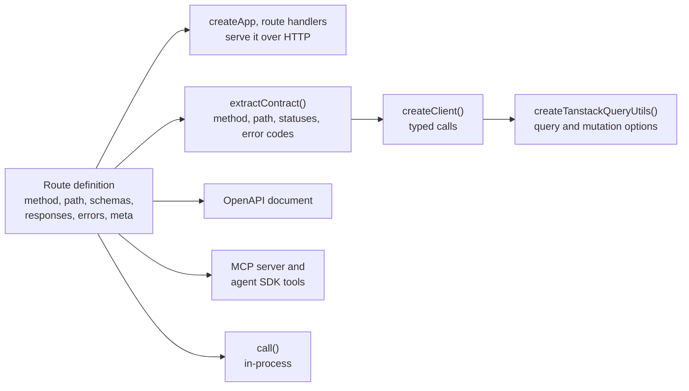
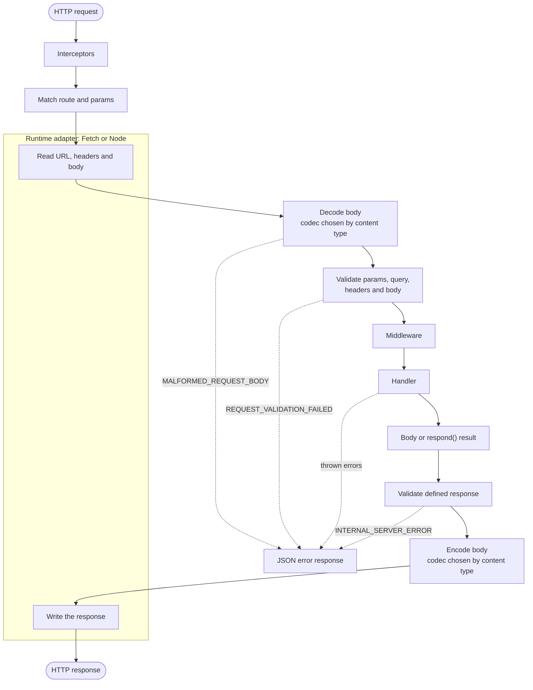

## A Route Is Data

The route builder records what each call declares: method, path, schemas,
responses, errors and metadata. The handler and middleware sit next to that
definition. Everything else reads the same definition:



- Nothing is generated. Types come from the definition's type, and runtime
  behavior from its value.
- A route tree is a plain object. A route's path, when not given, is its keys
  in the tree, resolved when the tree is served or extracted.
- An extracted contract keeps only what the client needs to send a request
  and check the response. Schemas, metadata and handlers stay on the server.
  See
  [`extract.ts`](https://github.com/simoalanne/rest-rpc/blob/main/packages/core/src/contract/extract.ts).

## Request Pipeline

`createApp`, the catch-all handler and route handlers all run the same
pipeline. Only reading the request and writing the response differ per
runtime. The core of it is
[`dispatch.ts`](https://github.com/simoalanne/rest-rpc/blob/main/packages/server/src/pipeline/dispatch.ts),
which reads and decodes the request, and
[`handleHttpRoute.ts`](https://github.com/simoalanne/rest-rpc/blob/main/packages/server/src/pipeline/handleHttpRoute.ts),
which validates it, runs the route and turns the result into a response:



### Less Work per Request

Every route is data that's known before the first request arrives, so the
pipeline works out ahead of time what each request needs and skips the rest:

- The route tree is compiled once, when the app or handlers are created.
  Paths are resolved, and routes are sorted so static segments match before
  params.
- `.static()` responses are validated and encoded once, at startup, and then
  sent with no further work.
- A route reads only what it declares. The query is parsed only when there's
  a `.query()` schema, and headers are read only when there's a `.headers()`
  schema.
- The body is decoded only when there's a `.body()` schema. Other routes
  ignore the body and its content type.
- Params are read only for `:name` segments. When a router, such as Bun's,
  has already matched them, they're reused.
- On Fetch runtimes, a JSON response without headers or cookies is sent with
  `Response.json()`, which skips the codec.

### Reading the Request

The body is read through one interface, whatever the runtime:

```ts
/** Read once, with one of its methods, like a Fetch body. */
type IncomingBody = {
	text(): Promise<string>;
	json(): Promise<unknown>;
	arrayBuffer(): Promise<ArrayBuffer>;
	blob(): Promise<Blob>;
	formData(): Promise<FormData>;
	readonly body: ReadableStream<Uint8Array> | null;
};
```

- On Fetch runtimes, it's the `Request` itself.
- On Node, it wraps the `IncomingMessage`, reads the stream when a codec asks
  for it, and decodes like Fetch does.

:::warning
On Node, a body a framework already parsed can't be read again. Pass it as
the [`body` option](/docs/server/framework-integration#handle-options).
:::

### Decoding

When a route has a body schema:

1. A headers schema is validated first, since it can declare which content
   types the route accepts.
2. A request with another content type gets `UNSUPPORTED_MEDIA_TYPE`.
3. The codec for the base media type decodes the body. A body it can't decode
   gets `MALFORMED_REQUEST_BODY`.

### Validation

Params, query, headers and body are validated together, so one
`REQUEST_VALIDATION_FAILED` lists the issues of every segment. Stacked schemas
of a segment run in order, and their outputs merge.

### Middleware and Handler

Middleware and the handler receive the validated values as
[handler arguments](/docs/route-builder#handler-arguments). Middleware wraps
the handler: what `next()` resolves with is the handler's result, as a
response with its status set.

### The Result

The handler's return value becomes a status, headers and a body, by the
defaults in [Responses](/docs/route-builder#responses). A returned `Response`
is sent as it is and skips the steps below.

Defined responses are then validated. A headers schema's output is what's
sent, so it decides which headers go out.

### Encoding

The response's `content-type` picks the
[codec](/docs/http-behavior/encoding), the same way the request's does. Event
streams and errors skip codecs.

The adapter writes the result as a Fetch `Response`, or to Node's
`ServerResponse`. A `HEAD` request runs the `GET` route and drops the body.

### Errors

A thrown `RouteError` is sent with its status, headers and a
`{ code, message, data }` body, from anywhere in the pipeline or an
interceptor. Any other thrown value is sent by `createApp` as
`INTERNAL_SERVER_ERROR`, and rejected by framework handlers for the framework
to handle.

## On the Client

The client runs the same steps in reverse, with the same codecs:

- **Request**: params fill the path, the query is serialized, and the body is
  encoded by the codec for its `content-type`, JSON by default.
- **Success**: the status must be one the route defines, if it defines any,
  and a stream must arrive for a stream response and only for one. The body
  is decoded by its content type.
- **Error**: a JSON body with a `code` becomes a `RouteError`, typed when the
  route defines that code with that status.

Clients don't validate responses by default, since the server already did.

## Local Calls

[`call()`](/docs/client/local-calls) runs every step from validation to
response validation, but skips the adapter and codecs.

## Source Code

To read further, start with these files:

- **Route definitions**:
  [`contract/routeBuilder.ts`](https://github.com/simoalanne/rest-rpc/blob/main/packages/core/src/contract/routeBuilder.ts),
  [`contract/extract.ts`](https://github.com/simoalanne/rest-rpc/blob/main/packages/core/src/contract/extract.ts)
- **Compiling and dispatching**:
  [`pipeline/dispatch.ts`](https://github.com/simoalanne/rest-rpc/blob/main/packages/server/src/pipeline/dispatch.ts),
  [`routing/match.ts`](https://github.com/simoalanne/rest-rpc/blob/main/packages/server/src/routing/match.ts),
  [`pipeline/staticResponse.ts`](https://github.com/simoalanne/rest-rpc/blob/main/packages/server/src/pipeline/staticResponse.ts)
- **Validation, middleware and results**:
  [`pipeline/validation.ts`](https://github.com/simoalanne/rest-rpc/blob/main/packages/server/src/pipeline/validation.ts),
  [`builder/middleware.ts`](https://github.com/simoalanne/rest-rpc/blob/main/packages/server/src/builder/middleware.ts),
  [`pipeline/handleHttpRoute.ts`](https://github.com/simoalanne/rest-rpc/blob/main/packages/server/src/pipeline/handleHttpRoute.ts)
- **Codecs**:
  [`codecs/types.ts`](https://github.com/simoalanne/rest-rpc/blob/main/packages/core/src/codecs/types.ts),
  [`codecs/registry.ts`](https://github.com/simoalanne/rest-rpc/blob/main/packages/core/src/codecs/registry.ts),
  [`codecs/defaults.ts`](https://github.com/simoalanne/rest-rpc/blob/main/packages/core/src/codecs/defaults.ts),
  [`pipeline/serializeHttpRouteResult.ts`](https://github.com/simoalanne/rest-rpc/blob/main/packages/server/src/pipeline/serializeHttpRouteResult.ts)
- **Runtime adapters**:
  [`fetch/response.ts`](https://github.com/simoalanne/rest-rpc/blob/main/packages/server/src/fetch/response.ts),
  [`node/request.ts`](https://github.com/simoalanne/rest-rpc/blob/main/packages/server/src/node/request.ts),
  [`node/response.ts`](https://github.com/simoalanne/rest-rpc/blob/main/packages/server/src/node/response.ts)
- **Client and local calls**:
  [`client/request.ts`](https://github.com/simoalanne/rest-rpc/blob/main/packages/core/src/client/request.ts),
  [`client/response.ts`](https://github.com/simoalanne/rest-rpc/blob/main/packages/core/src/client/response.ts),
  [`pipeline/call.ts`](https://github.com/simoalanne/rest-rpc/blob/main/packages/server/src/pipeline/call.ts)
